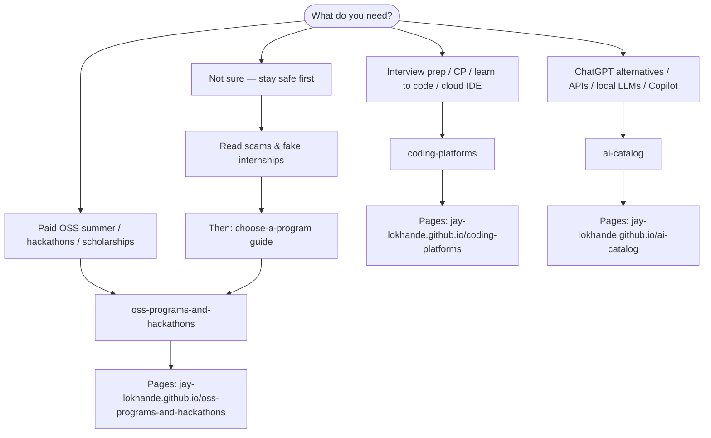

# Student Dev Catalogs

One **starting point** for Jay-Lokhande’s linked catalogs — OSS programs, AI tools, and coding platforms. No duplicate tables here; each catalog owns its own README and JSON.

> **Scams:** Fake internships and “pay to apply” offers are everywhere. Start with [OSS scams guide](https://github.com/Jay-Lokhande/oss-programs-and-hackathons/blob/main/resources/scams-and-fake-internships.md) before trusting random DMs.

**Navigation:** [NAVIGATION.md](NAVIGATION.md)

**Sister repos:** this repo is the **hub** — catalogs below.

---

## What to read first

Plain-text path:

1. **Unsure or got a suspicious offer?** → [Scams & fake internships](https://github.com/Jay-Lokhande/oss-programs-and-hackathons/blob/main/resources/scams-and-fake-internships.md)
2. **Pick a summer program** → [choose-a-program](https://github.com/Jay-Lokhande/oss-programs-and-hackathons/blob/main/resources/choose-a-program.md)
3. **Open the catalog** that matches your goal (table below)

---

## All catalogs

| Catalog | Best for | GitHub | GitHub Pages |
| --- | --- | --- | --- |
| **All You Have To Do Is Believe** | GSoC, Summer of Bitcoin, Outreachy, hackathons, scholarships | [oss-programs-and-hackathons](https://github.com/Jay-Lokhande/oss-programs-and-hackathons) | [Read](https://jay-lokhande.github.io/oss-programs-and-hackathons/) |
| **All The AIs** | Chat, coding AI, APIs, local LLMs, free tiers | [ai-catalog](https://github.com/Jay-Lokhande/ai-catalog) | [Read](https://jay-lokhande.github.io/ai-catalog/) |
| **Code Platforms** | LeetCode, Codeforces, MOOCs, Replit, deploy | [coding-platforms](https://github.com/Jay-Lokhande/coding-platforms) | [Read](https://jay-lokhande.github.io/coding-platforms/) |
| **Student Dev Catalogs** *(this hub)* | Links + “where to start” | [student-dev-catalogs](https://github.com/Jay-Lokhande/student-dev-catalogs) | [Read](https://jay-lokhande.github.io/student-dev-catalogs/) |

Machine-readable index: [data/catalogs.json](data/catalogs.json)

## Contribute

Fix a link or add a **new catalog repo** to the hub → [CONTRIBUTING.md](CONTRIBUTING.md)

## License

[CC BY 4.0](LICENSE)
