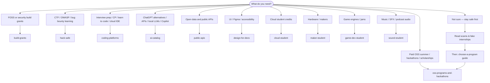

# Student Dev Catalogs

One **starting point** for Jay-Lokhande’s linked student catalogs — OSS, grants, security, APIs, design, cloud, makers, games, AI, and coding. No duplicate tables here; each catalog owns its own README and JSON. You can [navigate](NAVIGATION.md), find [Hub](https://jay-lokhande.github.io/student-dev-catalogs/) (all catalogs), and browse [Sister repos](resources/sister-repos.md).

> **Scams:** Fake internships, grants, and “pay to apply” offers are everywhere. Start with [OSS scams guide](https://github.com/Jay-Lokhande/oss-programs-and-hackathons/blob/main/resources/scams-and-fake-internships.md) before trusting random DMs.

**Pages:** [student-dev-catalogs](https://jay-lokhande.github.io/student-dev-catalogs/) · [oss-programs-and-hackathons](https://jay-lokhande.github.io/oss-programs-and-hackathons/) · [build-grants](https://jay-lokhande.github.io/build-grants/) · [hack-safe](https://jay-lokhande.github.io/hack-safe/) · [ai-catalog](https://jay-lokhande.github.io/ai-catalog/) · [coding-platforms](https://jay-lokhande.github.io/coding-platforms/) · [public-apis](https://jay-lokhande.github.io/public-apis/) · [design-for-devs](https://jay-lokhande.github.io/design-for-devs/) · [cloud-student](https://jay-lokhande.github.io/cloud-student/) · [maker-student](https://jay-lokhande.github.io/maker-student/) · [game-dev-student](https://jay-lokhande.github.io/game-dev-student/) · [sound-student](https://jay-lokhande.github.io/sound-student/) · [sound-student](https://jay-lokhande.github.io/sound-student/)

---

## What to read first

Plain-text path:

1. **Unsure or got a suspicious offer?** → [Scams & fake internships](https://github.com/Jay-Lokhande/oss-programs-and-hackathons/blob/main/resources/scams-and-fake-internships.md)
2. **Pick a summer program** → [choose-a-program](https://github.com/Jay-Lokhande/oss-programs-and-hackathons/blob/main/resources/choose-a-program.md)
3. **Open the catalog** that matches your goal (table below)

---

## All catalogs

| Catalog | Best for | GitHub | GitHub Pages |
| --- | --- | --- | --- |
| **All You Have To Do Is Believe** | GSoC, Summer of Bitcoin, Outreachy, hackathons, scholarships | [oss-programs-and-hackathons](https://github.com/Jay-Lokhande/oss-programs-and-hackathons) | [Read](https://jay-lokhande.github.io/oss-programs-and-hackathons/) |
| **Build Grants** | NLnet, Mozilla, GitHub Secure OSS, protocol grants | [build-grants](https://github.com/Jay-Lokhande/build-grants) | [Read](https://jay-lokhande.github.io/build-grants/) |
| **Hack Safe** | CTF, OWASP, official bug bounty platforms | [hack-safe](https://github.com/Jay-Lokhande/hack-safe) | [Read](https://jay-lokhande.github.io/hack-safe/) |
| **Public APIs** | Open data & API portals | [public-apis](https://github.com/Jay-Lokhande/public-apis) | [Read](https://jay-lokhande.github.io/public-apis/) |
| **Design for Devs** | Figma, design systems, WCAG | [design-for-devs](https://github.com/Jay-Lokhande/design-for-devs) | [Read](https://jay-lokhande.github.io/design-for-devs/) |
| **Cloud Student** | AWS / GCP / Azure student programs | [cloud-student](https://github.com/Jay-Lokhande/cloud-student) | [Read](https://jay-lokhande.github.io/cloud-student/) |
| **Maker Student** | KiCad, Arduino, makerspaces | [maker-student](https://github.com/Jay-Lokhande/maker-student) | [Read](https://jay-lokhande.github.io/maker-student/) |
| **Game Dev Student** | Godot, Unity, itch.io, jams | [game-dev-student](https://github.com/Jay-Lokhande/game-dev-student) | [Read](https://jay-lokhande.github.io/game-dev-student/) |
| **Sound Student** | DAWs, game audio, legal samples | [sound-student](https://github.com/Jay-Lokhande/sound-student) | [Read](https://jay-lokhande.github.io/sound-student/) |
| **All The AIs** | Chat, coding AI, APIs, local LLMs, free tiers | [ai-catalog](https://github.com/Jay-Lokhande/ai-catalog) | [Read](https://jay-lokhande.github.io/ai-catalog/) |
| **Code Platforms** | LeetCode, Codeforces, MOOCs, Replit, deploy | [coding-platforms](https://github.com/Jay-Lokhande/coding-platforms) | [Read](https://jay-lokhande.github.io/coding-platforms/) |
| **Student Dev Catalogs** *(this hub)* | Links + “where to start” | [student-dev-catalogs](https://github.com/Jay-Lokhande/student-dev-catalogs) | [Read](https://jay-lokhande.github.io/student-dev-catalogs/) |

Machine-readable index: [data/catalogs.json](data/catalogs.json)

## Contribute

Fix a link or add a **new catalog repo** to the hub → [CONTRIBUTING.md](CONTRIBUTING.md)

## License

[CC BY 4.0](LICENSE)
